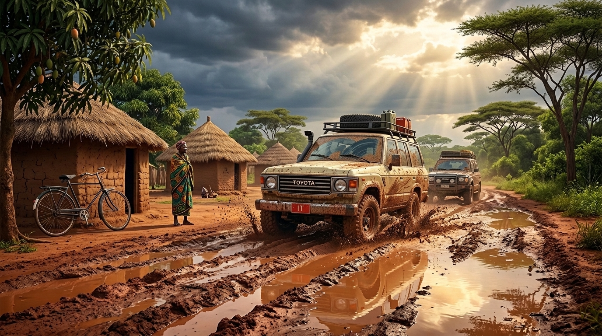

# AFRICAN IT DRIVERS — Перегон в Африке (80–90-е)

> **Браузерный 3D-симулятор перегона японских автомобилей через Восточную и Центральную Африку конца 1980-х — 1990-х годов.**

---

## Об игре и сеттинге

Конец 1980-х годов. Эпоха золотого бума надежных японских праворульных внедорожников и микроавтобусов. Тысячи подержанных **Toyota Hilux, Land Cruiser J40/J70 и HiAce** прибывают на сухогрузах в океанский порт **Дар-эс-Салам** (Танзания).

Чтобы не платить ввозные пошлины, водители-перегонщики получают специальные красные металлические транзитные номера **«IT» (In Transit)** и отправляются в эпический многодневный рейс через континент:
* От океанского побережья Дар-эс-Салама сквозь раскалённые саванны Танзании;
* Через Великий Северный тракт Замбии и пограничные посты;
* В самое сердце бездорожья и разбитых колей **Республики Заир** (провинция Шаба / Катанга, район Колвези и Мутшатши), где дороги превращаются в реки пластичной красной латеритной глины.

---

## Вдохновение и стиль

Проект объединяет в себе лучшие черты культовых игр:
1. **Spintires / MudRunner / SnowRunner** — честная физика деформации грунта (модель Беккера-Вонга), динамическая 3D-колея, налипание вязкой глины на протектор, пробуксовка, блокировки дифференциалов, пониженная передача и лебёдка за деревья.
2. **art of rally** — кинематографическая эстетика, стилизованная низкополигональная графика, выверенная цветовая палитра и романтика классических оффроуд-машин.
3. **Over the Hill** — тёплое ламповое освещение, уютная экспедиционная атмосфера и дух первооткрывательства.
4. **«Заря» (Zarya)** — душевная роуд-муви атмосфера приключений простого работяги, преодолевающего километры разбитых грунтовок на верной рабочей машине ради своей мечты и родной деревни.
5. Интерактивная 3D-основа в браузере на базе **Three.js** (в духе портфолио Bruno Simon).

---

## Доступная техника (Выбор клавишами 1–9, 0)

1. **🚛 Тягач «Тайга-6x6»** — тяжелый трехосный лесовоз 6x6 с блокировкой, понижайкой и лебедкой.
2. **🚙 Джип 4x4 «Следопыт»** — экспедиционный внедорожник с багажником и канистрами.
3. **🚗 Седан «Классика»** — заднеприводный городской автомобиль с низким клиренсом.
4. **🚌 Ретро-Автобус «ПАЗ Турист»** — автобус со сдвоенными задними колесами.
5. **🏎️ Спорткупе «Racer GT»** — низкопрофильное купе для скоростных участков.
6. **🛻 Land Cruiser J40 Пикап (FJ45L, 1979)** — 4x4, грузовая платформа, легендарный тяговитый мотор.
7. **🚙 Land Cruiser J40 Хардтоп (BJ44V, 1979)** — длиннобазный полноприводный универсал с жестким верхом.
8. **🏕️ Land Cruiser J40 Тент (BJ40, 1979)** — короткая база, мягкий верх, максимальная геометрическая проходимость.
9. **🚐 Mitsubishi Delica Star Wagon 4WD (Mk3)** — японский полноприводный рамный минивэн для экспедиций.
10. **📦 Toyota HiAce H50 Фургон (Mk3)** — классический заднеприводный коммерческий фургон для африканских дорог.

---

## Управление

* **1..9, 0**: Выбор автомобиля
* **W / Стрелка вверх**: Газ (акселератор)
* **S / Стрелка вниз**: Тормоз / Задний ход
* **A / D**: Поворот руля
* **Пробел (Space)**: Ручной тормоз
* **Q**: Переключение AWD (Полный привод 4x4)
* **E**: Переключение Diff Lock (Блокировка дифференциала)
* **R**: Пониженная передача (Low Gear)
* **F**: Лебедка (Winch) — зацепиться тросом за ближайшее дерево и подтягивать машину
* **C**: Смена камеры (Изометрия / От третьего лица / Вид сверху)
* **V**: Сброс / эвакуация авто на твердый грунт
* **L**: Включение / выключение фар
* **M**: Звук вкл/выкл

---

## Физика грунта, колея и налипание грязи

* **Модель Беккера-Вонга (`js/soil.js`)**: Поле грунта с шагом 10 см. Учитывает давление колес, глубину колеи, вытеснение грунта в боковые валики, уплотнение под колесами и скопление воды в низинах.
* **Тяга и скольжение (Кривая Янози)**: Реалистичный расчет сдвиговых напряжений грунта, открытый дифференциал, пробуксовка одного из колес при диагональном вывешивании.
* **Налипание грязи**: В липкой глине и болоте протектор забивается грязью, снижая тягу. Грязь срывается центробежной силой на высокой скорости и смывается при заезде в воду.
* **Деформация рельефа (`js/terrain_deform.js`)**: Динамическое смещение вершин сетки и попиксельный расчет нормалей колеи в реальном времени.

---

## Быстрый запуск

1. Двойной клик по **`start_game.bat`** — скрипт автоматически запустит локальный веб-сервер и откроет игру в браузере по адресу `http://localhost:8765`.
2. Если Python не установлен, скрипт автоматически использует встроенный Node.js сервер (`tools/serve.mjs`).

### Онлайн-демо
Проект доступен в браузере на GitHub Pages:  
👉 **[https://crabinacrabic.github.io/mudrunner-threejs/](https://crabinacrabic.github.io/mudrunner-threejs/)**

---

## Модели и лицензии

* 3D-модели **Land Cruiser J40** (все кузова), **Mitsubishi Delica Mk3 Star Wagon 4WD** и **Toyota HiAce Mk3 H50**: автор **[Nieve5677](https://sketchfab.com/iori308408)**, лицензия **CC BY 4.0**. Модели оптимизированы, колеса вынесены в отдельные независимые узлы подвески.
* Исходные модели техники 1–5: библиотека **Quaternius** (CC0 Public Domain).
* Дизайн и вдохновение: *art of rally* (Funselektor), *Spintires/MudRunner* (Saber/Oovee), *Over the Hill*, *Заря* и портфолио Bruno Simon.

---

## Документация проекта

* [`СЮЖЕТ.md`](СЮЖЕТ.md) — подробный сценарий «The I.T. Run», исторические маршруты, персонажи и пролог с велосипедом в деревне Мутшатша.
* [`ФИЗИКА.md`](ФИЗИКА.md) — математические формулы грунта, подвески и трансмиссии.
* [`ГРАФИКА.md`](ГРАФИКА.md) — шейдеры, палитра освещения, постобработка и декали.
