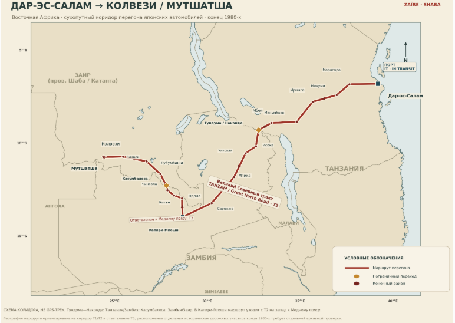

# СЮЖЕТ_1 — маршрут, сезоны и главы перегона Дар-эс-Салам → Мутшатша

> Статус: черновик дизайн-документа (2026-10-20). Проверка нашла 31 неточность, правки ещё **не внесены** (курс квачи, мотор BJ44, нет FJ60/Subaru в таблице машин и др.).

> Рабочий документ по дизайну, 2026-10-20.
>
> Источники документа:
> - анализ ChatGPT-6, который прислал пользователь: грунты и сезоны по маршруту, таблицы Беккера–Вонга, маршрут, деление на 5 глав, схема кода;
> - его карта маршрута;
> - `README.md`;
> - `ФИЗИКА-ГРУНТЫ-РЕВЬЮ.md`;
> - проверка фактов по открытым источникам.
>
> Черновик сюжета пользователя (`СЮЖЕТ.md`) здесь **не использован**. Своих героев и сюжетной линии в документе нет: на их месте стоят пометки «[место для сюжетной сцены пользователя]».

**Пометки достоверности** (стоят у каждого утверждения):
- **[ист]** — подтверждено источником (список в конце); **[ист: код]** — проверено по коду проекта;
- **[GPT]** — из анализа ChatGPT-6, отдельно не проверено;
- **[оценка]** — наш расчёт, сумма отрезков или допущение;
- **[идея]** — предложение для игры.

Названия покрытий и их состояний взяты из `ФИЗИКА-ГРУНТЫ-РЕВЬЮ.md` (далее «ревью»):
- асфальт с ямами и лужами;
- латерит: сухая корка / первый дождь (скользкая плёнка) / пластичный / жидкий;
- песок: сухой / влажный / насыщенный;
- гравий с гофрой;
- dambo;
- чёрная хлопковая глина (mbuga);
- броды (вода — слой над дном).

---

## 0. Коротко

**Завязка (по README).** Конец 1980-х. Подержанные японские праворульные машины приходят в порт Дар-эс-Салама. Перегонщики с транзитными номерами «IT» ведут их своим ходом через Танзанию и Замбию в Шабу (Заир), к Колвези и Мутшатше. Что показала проверка:

- **Путь существовал.** В конце 1980-х из Дар-эс-Салама в Шабу через Замбию шла асфальтированная дорога (Tanzam Highway). Грузы по ней шли ≈7–10 дней, но ездили по ней реже, чем южным путём через ЮАР **[ист]**. Пустая малоезжая трасса — исторически честный фон.
- **«Золотой бум» не подтверждается.** Массовый поток подержанных японских машин в Восточную Африку — это 1990-е–2010-е годы. В 1984–1989 гг. ввоз в Танзанию и Замбию сдерживала нехватка валюты **[ист]**. С 1984 г. Танзания разрешила ввоз за собственную валюту импортёра («own funds»), и в разрешённом списке были пикапы и автобусы **[ист]**. Для сюжета честнее «ручеёк» таких машин, а не тысячи **[оценка]**.
- **«IT» — современный термин.** Название «IT» (In Transit) для машин, которые гонят своим ходом из порта Дар-эс-Салама в Замбию, ДРК и Руанду, подтверждено только для 2020–2023 гг. **[ист]**. Красных металлических номеров «IT» в 1980-х не найдено. Танзанийские номера тех лет были жёлтыми у частных машин и белыми у автобусов, такси и прокатных машин, в формате T + две буквы + четыре цифры **[ист]**. Красные «IT» в 1988 г. — художественная условность **[оценка]**.
- **Мотив «не платить пошлину» подтверждается.** В Заире в 1988 г. легковые машины облагались пошлинами 60–90 % в сумме, грузовики — 50 % **[ист]**.

### Пять глав

Сезонное состояние дано для выезда из Дар-эс-Салама в конце октября **[идея]** (обоснование — §2.3).

| Глава | Участок | км | Главные покрытия | Сезонное состояние | Чему учит игрока |
|---|---|---|---|---|---|
| 1. Порт | Дар-эс-Салам → Морогоро | ≈196 **[ист]** | асфальт с ямами и лужами, песчаные обочины, латеритные дворы | на побережье начинаются короткие дожди: мокрый асфальт, лужи в ямах **[оценка]** | базовое управление, камера C, сброс V, полный привод Q на песке |
| 2. Микуми и Китонга | Морогоро → Микуми → Китонга → Иринга | ≈300–306 **[оценка]** | асфальт с колеями, гравийные объезды с гофрой, mbuga в пойме | сухо, жара, пыль, сухая корка **[оценка]** | понижайка R на подъёме, езда в колее, торможение перед животными |
| 3. Нагорье и граница | Иринга → Макамбако → Мбея → Тундума / Наконде | ≈438 **[оценка]** | асфальт нагорья, латеритные объезды | первые грозы: латерит «первый дождь», скользкая плёнка **[оценка]** | блокировка E и плавный газ на скользком, пограничный пост |
| 4. Великий Северный тракт и Медный пояс | Наконде → Мпика → Серенже → Капири-Мпоши → Ндола → Китве → Чингола → Касумбалеса | ≈1 060–1 100 **[оценка]** | стареющий асфальт с ямами, гравий с гофрой, dambo, мосты через Кафуэ | начало дождей: плёнка на латерите, dambo набирают воду **[оценка]** | лебёдка F, запас топлива, выбор пути |
| 5. Шаба | Касумбалеса → Лубумбаши → Ликаси → Колвези → Мутшатша | ≈510–560 **[оценка]** | разбитый асфальт; грунтовая RN39 — пластичный и жидкий латерит, обманчивая корка, броды | дожди установились: пластичная красная глина **[оценка]** | всё вместе + правостороннее движение |

Весь путь — ≈2 490–2 580 км **[оценка]** (сумма отрезков, §1.1).

---

## 1. Маршрут

### 1.1 Отрезки

Порядок городов у GPT правильный, но в нём не хватает городов **[ист]**:
- **Макамбако** — между Ирингой и Мбеей;
- **Мкуши** — между Серенже и Капири-Мпоши;
- **Чингола и Чилилабомбве** — между Китве и Касумбалесой;
- **Ликаси** — в описании главы 5.

Чинсали на маршрут не попадает: T2 обходит его стороной **[ист]**.

| # | Откуда → куда | км | Дорога: тогда / сейчас | Покрытие в конце 1980-х | Заметки |
|---|---|---|---|---|---|
| 1 | Дар-эс-Салам → Морогоро | ≈196 **[ист]** | Tanzam Highway / T1 | асфальт **[ист]**. Трассу строили по частям в 1968–1973 гг. **[ист]** | прибрежная равнина; Морогоро ≈500 м **[ист]** |
| 2 | Морогоро → Микуми | ≈110 **[оценка]** (502 − 196 − 193) | то же | асфальт **[ист]** | ≈50 км через нацпарк Микуми, от ворот Дома до городка Микуми **[ист]** |
| 3 | Микуми → Иринга | ≈193 **[ист]** | то же | двухполосный асфальтобетон 1973 г. Капитального ремонта не было; на Китонге глубокие колеи от грузовиков **[ист]** | подъём Китонга: ≈10 км, уклоны 7–8 %, ≈450 км от Дара **[ист]**; Иринга выше 1 550 м **[ист]** |
| 4 | Иринга → Макамбако → Мбея | ≈335 **[ист]** | то же; в Макамбако T1 сходится с T6 **[ист]** | асфальт **[ист]** | местами выше 2 000 м **[ист]**; Мбея ≈1 700 м **[ист]** |
| 5 | Мбея → Тундума | ≈103 **[ист]** | то же | асфальт **[ист]** | граница; рядом граница железной дороги TAZARA **[ист]** |
| | **Итого Дар → Тундума** | **924 [ист]** (JICA ≈920, NEPAD 921) | | | строки 1–5 в сумме дают ≈937: источники расходятся на 1–2 % **[оценка]** |
| 6 | Наконде → Исока | 86 **[ист]** | Great North Road / T2 | асфальт, к концу 1980-х изношенный **[ист]** | участок Мпика–Наконде улучшали в 1960-х **[ист]** |
| 7 | Исока → Мпика | 263 **[ист]** | то же | то же **[ист]** | дорога обходит Чинсали **[ист]** |
| 8 | Мпика → Серенже | 245 **[ист]** | то же | двухполосный битум начала 1970-х **[ист]** | |
| 9 | Серенже → Мкуши → Капири-Мпоши | ≈200 **[ист]** | то же | асфальт **[ист]**; ямы на T2 не задокументированы, это допущение игры **[оценка]** | Т-образная развилка T2/T3 чуть севернее города; конечная станция TAZARA (с 1976 г.) **[ист]** |
| | **Итого Наконде → Капири-Мпоши** | **794–832 [ист]** | | | 794 — сумма отрезков; 832 — статья о Tanzam Highway |
| 10 | Развилка у Капири-Мпоши → Ндола | ≈110 **[ист]** | T3, идёт **на север** **[ист]** | вероятно, асфальт, по полосе в каждую сторону. Дата укладки не найдена **[оценка]** | нынешние четырёхполосные участки — проекты 2010-х (Ндола–Китве: 2013–2018) **[ист]** |
| 11 | Ндола → Китве | ≈54 **[ист]** | T3 | то же **[оценка]** | въезд в центр Китве по мосту через Кафуэ **[ист]** |
| 12 | Китве → Чингола | ≈50 **[ист]** | T3 через Чамбиши, город в стороне | то же **[оценка]** | развилка с T5 на Солвези и Анголу **[ист]** |
| 13 | Чингола → Чилилабомбве | ≈17 **[ист]** | T3 | то же **[оценка]** | второй мост через Кафуэ **[ист]** |
| 14 | Чилилабомбве → Касумбалеса | ≈17 **[ист]** | T3 | то же **[оценка]** | граница с Заиром **[ист]** |
| | **T3 целиком** | **263 [ист]** | | | |
| 15 | Касумбалеса → Лубумбаши | 88–100 **[ист]** | сейчас N1 **[ист]** | не выяснено. Во всём Заире в 1986 г. было 2 400 км асфальта **[ист]**; что этот участок входил в их число, вероятно, но не проверено **[оценка]** | |
| 16 | Лубумбаши → Ликаси | 124–141 **[ист]** | N1 | старый асфальт. Всемирный банк планировал его ремонт (141 км), но ремонт отменили: заявки оказались дорогими, денег не хватило **[ист]** | вероятно, пересекает Луфиру; где мост — не найдено **[оценка]** |
| 17 | Ликаси → Колвези | 185–187 **[ист]** | N1 до Нгубы, дальше N39 **[ист]** | не установлено: асфальт или частично гравий **[оценка]**. В 2006 г. 350 км от Лубумбаши до Колвези ехали 3–5 дней **[ист]** | по географии должна пересекать Луалабу; место моста не найдено **[оценка]** |
| 18 | Колвези → Мутшатша | 110–130 **[оценка]** | RN39 (N39) **[ист]** | грунт / латерит. В недатированном инвентаре Office des Routes участок Колвези–Мутшатша–Касаджи — 300 км, из них асфальта 0 км **[ист]**. Состояние в 1980-х — допущение **[оценка]** | по прямой ≈112 км почти строго на запад (расчёт по координатам) **[оценка]**; аэропорт–аэропорт 121 км **[ист]**; спуск ≈160 м **[оценка]** |
| | **Итого Касумбалеса → Мутшатша** | **≈510–560 [оценка]** | | | |
| | **Весь путь Дар → Мутшатша** | **≈2 490–2 580 [оценка]** | | | Дар → Колвези ≈2 380–2 450 **[оценка]** |

Расстояния в Заире — современные, от перевозчиков и Всемирного банка. Трасса 1980-х могла идти немного иначе **[ист]**.

### 1.2 Профиль высот

| Точка | Высота, м | |
|---|---|---|
| Дар-эс-Салам | 0 (уровень моря) | **[ист]** |
| Морогоро | ≈500 | **[ист]** |
| Китонга | высоты низа и верха подъёма не найдены | **[ист: не найдено]** |
| Иринга | выше 1 550 | **[ист]** |
| Южное нагорье | местами выше 2 000; точная высшая точка Tanzam не найдена | **[ист]** |
| Мбея | ≈1 700 (аэропорт 1 707); рядом гора Лолеза 2 809 и вулкан Рунгве 2 961 | **[ист]** |
| Касумбалеса | 1 420 | **[ист]** |
| Лубумбаши | 1 208 | **[ист]** |
| Колвези | 1 448 | **[ист]** |
| Мутшатша | 1 287 | **[ист]** |

Для игры **[идея]**: перегрев на подъёмах, тормоза на длинных спусках, холодные ночи в нагорье. Механики перегрева и износа тормозов в игре сейчас нет.

### 1.3 Границы и сторона движения

- **Тундума (Танзания) / Наконде (Замбия).** Город-близнец на границе. Здесь же границу пересекает TAZARA, поэтому дорожный и железнодорожный погранпосты стоят рядом **[ист]**. Как граница работала в 1980-х, источники не говорят **[ист: не найдено]**. Сегодня там единый пост (с октября 2019 г.) и больше 1 000 грузовиков в день **[ист — современность]**.
- **Касумбалеса (Замбия / Заир).** Здесь кончается T3, дальше на Лубумбаши идёт N1 **[ист]**. В заирской Касумбалесе по переписи 1984 г. жили 31 773 человека **[ист]**. Сегодня — больше 500 грузовиков в день в каждую сторону и очереди до 67–72 км **[ист — современность]**.
- **Смена стороны движения.** В Танзании и Замбии движение левостороннее (британское наследие), в Заире — правостороннее (бывшая бельгийская колония) **[ист]**. На Касумбалесе игрок переходит на правую сторону **[ист]**.
- **Праворульные машины в Заире.** Сегодня в ДРК они законны и распространены, особенно на юго-востоке **[ист]**. Для 1980-х это не проверено. Косвенный довод: в 1989 г. большая часть автомобильного импорта в Шабу шла из ЮАР, где движение левостороннее **[ист]**, так что праворульные машины в Шабе правдоподобны **[оценка]**.

### 1.4 Названия дорог

- Названия эпохи — **Tanzam Highway** (Танзания) и **Great North Road**, Великий Северный тракт (Замбия) **[ист]**.
- Танзанийская классификация T/R введена законом о дорогах 2007 г. В более старых списках участок Дар–Иринга значится как A7 **[ист]**. Номер «T1» на указателе 1988 г. — анахронизм **[оценка]**.
- Замбийские номера T и заирские номера RN к 1980-м привязать не удалось **[ист: не найдено]**.
- Для игры: на указателях названия и направления без номеров; в Танзании можно писать «A7» **[идея]**.
- Реки **Чамбеши и Луапула основной маршрут не пересекает**. Через Чамбеши ведут дорога M1 Мпика–Касама и TAZARA. Луапулу пересекает только боковая дорога «Конголезского выступа» у Чембе; паром там ходил до 2008 г. **[ист]**.

### 1.5 Карта маршрута и её ошибки



**Что на карте верно** (замер по координатной сетке: ≈31,5 px на градус) **[ист]**:
- линия маршрута и её узлы совпадают с настоящими городами в пределах ≈0,2°; узлы слегка сдвинуты к востоку;
- порядок городов правильный;
- оба погранперехода (Тундума/Наконде и Касумбалеса) стоят на своих местах;
- финишная звезда — у Мутшатши (≈24,6° в. д., 10,7° ю. ш.).

**Ошибки подписей** **[ист]** (большинство сдвинуто на 0,7–1,7° к западу или северо-западу от своих узлов):
1. «Колвези» висит ≈0,7° (≈75 км) севернее линии, а у узла Колвези стоит подпись «Ликаси». Настоящий узел Ликаси (≈26,9° в. д.) без подписи, поэтому Колвези легко принять за Ликаси.
2. «Лубумбаши» — ≈0,8° к северо-востоку от узла.
3. «Касумбалеса» — ≈1,5° западнее пограничного ромба (≈26,3° в. д.). На самом деле Касумбалеса почти точно к северу от Чинголы, на 27,8° в. д.
4. «Чингола» — ≈0,8° западнее узла.
5. «Китве» нарисован юго-западнее маршрута и южнее Ндолы. На самом деле Китве к западо-северо-западу от Ндолы (12,80° ю. ш. против 12,97°).
6. «Капири-Мпоши» — ≈0,7° южнее развилки.
7. «Мутшатша» — ≈0,9° западнее и ≈0,7° южнее звезды, по ту сторону границы ДРК.
8. «Мбея» стоит на юго-восточном конце озера Руква, ≈0,7° к северо-западу от Мбеи.
9. «Тундума / Наконде» — ≈1,7° западнее своего ромба.
10. «Морогоро», «Микуми», «Иринга» — ≈0,7–0,8° к северо-западу от узлов.
11. «Чинсали» подписан ≈0,9° западнее настоящего места; к тому же он не на маршруте.
12. «Макумбако» — опечатка, правильно «Макамбако».
13. Нет Чилилабомбве — последнего замбийского города на T3.
14. Надпись «ТАНЗАНИЯ» лежит поперёк границы с Мозамбиком по Рувуме.

**Ошибки подписи под картой** **[ист]**:
- «В Капири-Мпоши маршрут уходит с T2 на запад к Медному поясу» — неверно: от развилки T3 идёт на **север**, к Ндоле (≈110 км).
- «Коридор T1/T2» смешивает нынешнюю танзанийскую T1 с замбийской T2. В Замбии T1 — другая дорога (Чома–Ливингстон), а в 1980-х танзанийский участок T1 ещё не назывался. Для эпохи правильнее «Tanzam Highway / Great North Road».

Совет: перерисовать подписи или подписать узлы прямо на линии **[идея]**.

---

## 2. Сезоны

### 2.1 Календарь по месяцам

В колонке Катанги: Лубумбаши — мм осадков / дождливых дней **[ист]**; в скобках Колвези, мм (данные WorldClim 1970–2000 через сайт-агрегатор, источник слабее) **[ист]**. Колонка «На дороге» — наш перевод погоды в состояния покрытий из ревью **[оценка]**.

| Месяц | Побережье (Дар) | Внутренняя Танзания (Морогоро–Мбея) | Север Замбии | Юг Катанги | На дороге **[оценка]** |
|---|---|---|---|---|---|
| Янв | затишье между сезонами, ≈110 мм за янв–фев **[ист]** | дожди **[ист]** | дожди; дек–янв — самые дождливые **[ист]** | 253 / 24 (219) **[ист]** | латерит пластичный → жидкий, dambo под водой |
| Фев | затишье **[ист]** | дожди **[ист]** | дожди **[ист]** | 257 / 23 (205) **[ист]** | то же |
| Мар | длинные дожди (masika), мар–май ≈610 мм **[ист]** | дожди; в Морогоро пик мар–апр **[ист]** | дожди **[ист]** | 202 / 21 (221) **[ист]** | то же |
| Апр | длинные дожди **[ист]** | хвост дождей; Морогоро ≈204 мм **[ист]** | конец дождей **[ист]** | 60 / 9 — хвост **[ист]** | пластичный, местами подсыхает |
| Май | длинные дожди кончаются **[ист]** | сухо **[оценка]** | начало прохладного сухого сезона **[ист]** | 4 (8) **[ист]** | подсыхание, корка |
| Июн–авг | сухо, за июн–сен меньше 100 мм **[ист]** | сухо; Морогоро меньше 16 мм в месяц; Иринга почти без дождей **[ист]** | прохладно и сухо, в низинах бывают заморозки **[ист]** | 0–1 (0–2) **[ист]** | сухая корка, пыль, гофра, трещины в глине |
| Сен | сухо **[ист]** | сухо **[ист]** | жаркий сухой сезон (с середины августа или с сентября) **[ист]** | 4 **[ист]** | пыли больше всего |
| Окт | короткие дожди (vuli) начинаются в октябре или ноябре, источники расходятся **[ист]** | сухо и жарко; дожди приходят в ноябре–декабре **[ист]** | жаркий сухой сезон **[ист]** | 37 / 5 — переход; самый жаркий месяц (средний максимум 31 °C) **[ист]** | первые грозы: «первый дождь», скользкая плёнка |
| Ноя | короткие дожди, окт/ноя–дек ≈350 мм **[ист]** | начало дождей: ноябрь (FEWS NET) или декабрь (TMA) **[ист]** | начало дождей (ноя–апр, на севере чуть раньше) **[ист]** | 163 / 17 (189) — дожди установились **[ист]** | плёнка → пластичный латерит |
| Дек | короткие дожди **[ист]** | дожди **[ист]** | разгар дождей **[ист]** | 257 / 24 (243) **[ист]** | пластичный латерит, dambo под водой |

Поправки к календарю GPT:
- В Замбии прохладный сухой сезон начинается в **мае**, а не в апреле: апрель ещё конец дождей **[ист]**.
- В Катанге дожди устанавливаются уже в **ноябре**, а не «с середины ноября» **[ист]**.
- Морогоро по ФАО относится к районам с одним сезоном дождей **[ист]**. Два сезона (masika и vuli) — это побережье.

### 2.2 Как погода переводится в состояния грунта

Состояния — из ревью §3–§4. Факты о поведении материалов подтверждены там источниками:
- латерит скользкий при первом намокании и пластичный при затяжном дожде **[ист]**;
- влажный песок прочнее сухого и насыщенного **[ист]**;
- гофра появляется на скорости выше ≈1,5 м/с **[ист]**;
- dambo — сезонно заболоченная травяная низина **[ист]**;
- чёрная хлопковая глина в засуху трескается, а в дождь почти непроходима **[ист]**.

| Погода | Латерит / глина | Песок | Гравий | Асфальт | Dambo / mbuga |
|---|---|---|---|---|---|
| Сухо | сухая корка, пыль; может лежать на мягком основании | сухой рыхлый: вязнет, большое сопротивление качению | гофра, пыль | сухой | корка с трещинами, тряска |
| Первый дождь | скользкая плёнка 1–2 см поверх твёрдой основы: просадки нет, руль слабеет | влажный — самый прочный | мокрый латеритный гравий скользкий | мокрый, лужи в ямах | корка, сверху вода |
| Дожди установились | пластичный: колея, налипание, днище | у воды насыщенный, «плывёт» | почти без изменений | лужи прячут глубину ям, на скорости аквапланирование | вода по траву, мягкое дно |
| Разгар дождей | жидкий: колесо идёт до плотного дна, вязкое сопротивление | насыщенный | размыв | местами смыт | глубокая вода, без лебёдки не пройти |

Числа для плёнки (μ ≈ 0,2–0,35) и прочности по индексу текучести в ревью помечены как расчёт или гипотеза. Здесь это **[оценка]**.

### 2.3 Рекомендуемый месяц выезда **[идея]**

**Выехать из Дар-эс-Салама около 20–25 октября 1988 г. и добраться до Мутшатши примерно к середине ноября.**

Почему:
1. Погода по пути сама проходит цепочку «пыль → скользкий первый дождь → пластичная грязь». Это ровно те состояния, которые ревью предлагает сделать в физике **[оценка]**.
2. Каждая задержка (граница, топливо, поломка) отодвигает приезд глубже в сезон дождей, и финал становится тяжелее. Получается механика «гонки с дождями» **[идея]**.
3. Уровень «Мутшатша (Заир, 1988)» в игре уже датирован 1988 годом **[ист: код]**.
4. Темп обесценивания денег даёт фон: в Заире 130 заиров за доллар в январе 1988 г. и 300 в январе 1989 г. **[ист]**.

| Глава | Дни игры **[идея]** | Погода по календарю **[оценка]** |
|---|---|---|
| 1. Порт | 20–21 октября | на побережье начинаются короткие дожди, один ливень |
| 2. Микуми и Китонга | 22–24 октября | сухо, жара, пыль |
| 3. Нагорье и граница | 25–28 октября | сухо, первая гроза в нагорье |
| 4. Замбия | 29 октября – 7 ноября | начинаются дожди: плёнка, dambo набирают воду |
| 5. Шаба | 8–15 ноября | дожди установились: пластичная красная глина |

- **Длительность.** Грузы шли из Дара в Шабу по дороге ≈7–10 дней **[ист]**. Для перегона легковой машины с границами и поломками 2–3 недели игрового времени — разумная цифра **[оценка]**.
- **Лёгкий вариант.** Выезд в конце сентября: весь путь по сухому, в финале только первые грозы (октябрь в Лубумбаши — 37 мм за 5 дней) **[оценка]**.
- **Тяжёлый вариант.** Выезд в декабре: мокро уже со 2-й главы, в Шабе разгар дождей (около 250 мм и 23–24 дождливых дня в месяц) **[оценка]**.

---

## 3. Главы

Механики в игре сейчас **[ист: код / README]**:
- Q — полный привод;
- E — блокировка дифференциала;
- R — понижающая передача;
- F — лебёдка за ближайшее дерево;
- V — сброс на твёрдый грунт;
- C — камера;
- L — фары;
- Space — ручной тормоз.

Давления в шинах, топлива, денег, документов и перегрева в игре нет. Где они упомянуты, это **[идея]**.

Сопоставление с типами `SoilSim` сделано по таблице ревью §4.5: асфальт → `concrete`, латерит → `clay`, dambo → `swamp`, лесная тропа → `forest`.

### Глава 1. Порт: Дар-эс-Салам → Морогоро

**Точки маршрута:** порт Дар-эс-Салама → выезд из города по Tanzam Highway → прибрежная равнина → Морогоро. Около 196 км; Морогоро на высоте ≈500 м **[ист]**.

**Исторический контекст**
- **Президент и реформы.** С 5 ноября 1985 г. президент — Али Хасан Мвиньи, по прозвищу «Mzee Rukhsa» («всё дозволено») **[ист]**. 19 июня 1986 г. шиллинг девальвировали с 17 до 40 за доллар, дальше курс постепенно сползал. 28 августа 1986 г. Танзания попросила у МВФ кредит «стэнд-бай» ≈78 млн $: это и есть программа восстановления экономики (ERP) **[ист]**. К 31 марта 1990 г. доллар стоил 200 шиллингов **[ист]**.
- **Ввоз за свою валюту.** С 1984 г. можно ввозить товары за собственную валюту («own funds»): запчасти, стройматериалы, ткани, пикапы и автобусы **[ист]**. Формально механизм Own Funds Facility и открытая генеральная лицензия работали в 1988–1990 гг., и до 1991–1993 гг. их охват был узким **[ист]**. Были ли пикапы новыми или подержанными, японскими или нет, источник не говорит **[ист]**.
- **Железная дорога и нефтепровод.** Из Дар-эс-Салама в Замбию идут железная дорога TAZARA и нефтепровод TAZAMA до Ндолы (1968 г.) **[ист]**. TAZARA построили в 1970–1975 гг. на беспроцентный китайский кредит ≈406 млн $; в 1987 г. она перевезла 1,22 млн т грузов **[ист]**.
- **Дороги.** После ≈15 лет запущенности в мае 1990 г. проезжими были меньше 15 % дорог Танзании, а в хорошем состоянии — 15 % магистралей. Время в пути выросло в 2–3 раза, в сезон дождей движение часто прерывалось **[ист]**. Это цифры по всей сети, а не по одной TANZAM **[ист]**. В декабре 1987 г. донорская конференция в Аруше приняла план восстановления дорог **[ист]**.
- **Отличительные знаки.** Транспортные правила 1933 г. требуют от трансграничных коммерческих машин «отличительных знаков» (правило 15). Текст правила получить не удалось **[ист]**.

**Покрытия и их состояния**

| Где | Покрытие (ревью) | Состояние в главе | `SoilSim` |
|---|---|---|---|
| Порт, контейнерная площадка | асфальт / бетон | сухой, после ливня мокрый | `concrete` |
| Улицы, трасса | асфальт с ямами и лужами | лужи прячут глубину ям; на скорости аквапланирование (формула Хорна **[ист]**) | `concrete` + лужи `PUD` |
| Обочины, объезды пробок | песок | сухой — вязнет; влажный после ливня держит лучше всего **[ист]** | `sand` |
| Дворы, съезды | латерит | сухая корка, пыль | `clay` (сухой) |

Почвы побережья по GPT: песчаные Arenosols, красные Ferralsols и Acrisols, речные наносы Fluvisols, переувлажнённые Gleysols в низинах **[GPT]**.

**Погода.** На побережье начинаются короткие дожди (октябрь или ноябрь) **[ист]**. В главе один короткий ливень, жара и влажность **[идея]**.

**Ключевые испытания и события** **[идея]**
- Получить машину и транзитные бумаги в порту (мини-игра с документами; номера «IT» — условность, см. §0).
- Первый ливень: в ямах вода, глубины не видно; на скорости машину «несёт» по луже.
- Узкая двухполосная трасса **[оценка]**: обгон грузовиков при левостороннем движении **[ист]**, где праворульная машина «своя».
- Объезд пробки по песчаной обочине: без полного привода машина садится, с Q выезжает.

**Механики главы:** W/S/A/D, Space, C, L; V — сброс; Q — полный привод на песке. Давление шин (спустить на песке, подкачать на асфальте) — только предложение, в ревью §4.2 это поле `tyrePressure` **[идея]**.

**Цель главы:** вывезти машину из порта и довести её до Морогоро без повреждений **[идея]**.

> [место для сюжетной сцены пользователя: порт, получение машины]
>
> [место для сюжетной сцены пользователя: выезд из Дар-эс-Салама]

### Глава 2. Микуми и подъём Китонга: Морогоро → Микуми → Иринга

**Точки маршрута:** Морогоро → ворота Дома → ≈50 км через национальный парк Микуми → городок Микуми → подъём Китонга → Иринга. Около 300–306 км **[оценка]**.

**Исторический контекст**
- **Парк Микуми.** Создан в 1964 г., площадь 3 230 км². Трасса Морогоро–Иринга режет его пополам на ≈50 км между воротами Дома и городком Микуми **[ист]**. К северо-западу лежит пойма реки Мкаты; высшая точка парка — Малундве, 1 290 м **[ист]**. В парке живут слоны, буйволы, зебры, жирафы, канны, куду, гну, импалы и павианы, в прудах — бегемоты **[ист]**. Сегодня на этом участке машины сбивают ≈360–400 животных в год. Одиннадцатилетнее исследование насчитало 456 сбитых млекопитающих, в том числе 135 буйволов, 17 слонов и 17 жирафов **[ист — современные данные]**.
- **Ущелье Китонга** (горы Удзунгва). ≈10 км крутых уклонов (7–8 %) с повторяющимися крутыми поворотами, ≈450 км от Дара и ≈50 км до Иринги **[ист]**. Асфальт 1973 г. капитально не ремонтировали: глубокие колеи от перегруженных грузовиков, размытые обочины, плохой водоотвод, высокая аварийность **[ист]**. Сегодня дорогу там перекрывают грузовики, которые ломаются или теряют сцепление на подъёме **[ист]**.
- **Перед подъёмом.** По туристическому описанию, дорога перед подъёмом идёт долиной Большой Руахи **[оценка — не подтверждено]**. Есть ли мост через Руаху, не выяснено.
- **Ремонт TANZAM.** Кредит IDA на 50 млн $ одобрили 6 мая 1986 г.: ≈300 км TANZAM и гравийные дороги. В 1989 г. проект пересмотрели: 370 км TANZAM и 130 км гравийных дорог. Закрыт 30 июня 1994 г. **[ист]**. Заём Африканского фонда развития одобрили в ноябре 1987 г., первые деньги пришли в декабре 1989 г. Перерасход в 54 % урезал объём работ, а задержки дали дороге разрушиться сильнее **[ист]**. Значит, в 1988 г. ремонтных лагерей на трассе мало, а объезды и регулировщики — это в основном 1989–1990 гг. **[оценка]**.

**Покрытия и их состояния**

| Где | Покрытие (ревью) | Состояние в главе | `SoilSim` |
|---|---|---|---|
| Трасса через парк | асфальт с ямами | сухой | `concrete` |
| Китонга | асфальт с колеёй от грузовиков | сухой; колея ведёт колёса | `concrete` + рельеф колеи |
| Объезд дорожных работ (если 1989 г.) | гравий (мурам) с гофрой | сухой, пыль; гофра от ≈1,5 м/с **[ист]** | `concrete` (гофры в коде нет) |
| Пойма Мкаты, просёлки | чёрная хлопковая глина (mbuga) | сухая: трещины, тряска **[ист]** | `clay` (сухой) |
| Обочины | латерит | сухая корка, пыль | `clay` |

Почвы внутренней Танзании по GPT: Cambisols, Ferralsols, Lixisols, Acrisols; на склонах тонкие Leptosols; в долинах Fluvisols, Planosols, Vertisols **[GPT]**.

**Погода.** В конце октября внутренние районы ещё сухие: дожди здесь начинаются в ноябре или декабре **[ист]**. Жара, пыль, шлейф за машиной **[оценка]**.

**Ключевые испытания и события** **[идея]**
- **Животные на асфальте:** стадо буйволов, слон, жирафы. Штраф за наезд: нынешние рейнджеры штрафуют в зависимости от вида животного **[ист]**, для 1980-х это не проверено.
- **Китонга — главная сцена главы.** Сломанный перегруженный грузовик перекрыл полосу; обгон на слепом повороте; колея тянет машину; на спуске нужно тормозить двигателем.
- **Объезд дорожных работ по гравию с гофрой:** быстро — трясёт и уводит, медленно — долго.
- **Боковой просёлок через mbuga:** в сухую погоду он быстрый, но жёсткий.

**Механики главы:** R — понижайка на подъёме Китонги; езда в колее; торможение перед животными; выбор скорости на гофре.

**Цель главы:** проехать Микуми, никого не сбив, и подняться на плато к Иринге **[идея]**.

> [место для сюжетной сцены пользователя: парк Микуми]
>
> [место для сюжетной сцены пользователя: подъём Китонга]

### Глава 3. Южное нагорье и граница: Иринга → Макамбако → Мбея → Тундума / Наконде

**Точки маршрута:** Иринга (выше 1 550 м) → Макамбако, где T1 сходится с T6 → Мбея (≈1 700 м) → Тундума (≈103 км к юго-западу от Мбеи) → граница → Наконде **[ист]**. Около 438 км **[оценка]**.

**Исправление к GPT.** У GPT третья глава — «подъёмы, спуски, горные участки». Но главный горный подъём, Китонга, находится до Иринги, то есть во второй главе. В третьей главе — высокое плато и перевалы выше 2 000 м **[ист]**.

**Исторический контекст**
- **Высоты.** Местами Tanzam поднимается выше 2 000 м; точная высшая точка не найдена **[ист]**. У Мбеи стоят гора Лолеза (2 809 м) и вулкан Рунгве (2 961 м) **[ист]**.
- **Тундума и Наконде.** Город-близнец; погранпосты дороги и TAZARA стоят рядом **[ист]**. Очереди 1980-х не задокументированы **[ист: не найдено]**.
- **Замбийская квача.** Валютный аукцион шёл с октября 1985 по май 1987 г.: квача сразу упала с ≈2,2 до ≈6 за доллар, а за следующий год — с ≈7 до ≈21 **[ист]**. В мае 1987 г. правительство вернуло валютный контроль и установило курс 8 квач за доллар, тогда как свободный курс был ≈21 **[ист]**. Курс 1988 г. не найден **[ист: не найдено]**.

**Покрытия и их состояния**

| Где | Покрытие (ревью) | Состояние в главе | `SoilSim` |
|---|---|---|---|
| Трасса нагорья | асфальт с ямами | сухой, в грозу мокрый | `concrete` |
| Латеритный объезд | латерит | сухая корка → первый дождь: скользкая плёнка **[ист]** | `clay` |
| Каменистые выходы на подъёмах | скала (ревью, группа P3) | сухая, в дождь скользкая **[оценка]** | `concrete` |
| Площадка у границы | утоптанный грунт | пыль или лужи | `forest` / `grass` |

**Погода.** Конец октября: в нагорье дожди начинаются в ноябре или декабре **[ист]**, но первая гроза уже возможна **[оценка]**. На высоте прохладные ночи **[оценка]**.

**Ключевые испытания и события** **[идея]**
- **Гроза на латеритном объезде.** За минуты сухая корка превращается в «каток»: машина не проваливается, но руль слабеет (ревью §4.3).
- **Перевал выше 2 000 м** и длинный спуск к Мбее.
- **Граница Тундума / Наконде:** документы, очередь, обмен шиллингов на квачи. Выбор: официальный курс или чёрный рынок с риском.

**Механики главы:** E — блокировка дифференциала и плавный газ на скользкой плёнке; R — торможение двигателем на спусках; мини-игра на границе **[идея]**.

**Цель главы:** перевалить нагорье, пока не пришла гроза, и пересечь границу Замбии **[идея]**.

> [место для сюжетной сцены пользователя: нагорье]
>
> [место для сюжетной сцены пользователя: граница Тундума / Наконде]

### Глава 4. Великий Северный тракт и Медный пояс: Наконде → Касумбалеса

**Точки маршрута** **[ист]**:
Наконде → Исока (86 км) → Мпика (263) → Серенже (245) → Мкуши → Капири-Мпоши (≈200) → поворот **на север** по T3 → Ндола (≈110) → мост через Кафуэ → Китве (≈54) → Чамбиши → Чингола (≈50) → второй мост через Кафуэ → Чилилабомбве (≈17) → Касумбалеса (≈17).

Всего ≈1 060–1 100 км **[оценка]**. У GPT четвёртая глава кончается в Ндоле, а пятая начинается в Касумбалесе. Отрезок Ндола → Касумбалеса (≈140 км) выпадал, здесь он добавлен в главу 4 **[оценка]**.

**Исторический контекст**
- **«Hell Run».** Родезия в одностороннем порядке провозгласила независимость в 1965 г. После этого дорога от Капири-Мпоши к Танзании стала единственным путём для топлива и грузов из Дар-эс-Салама. Водители прозвали её «The Hell Run» за плохое покрытие и множество аварий **[ист]**. Потом основную нагрузку забрали нефтепровод TAZAMA (1968) и TAZARA (1975) **[ист]**. Подробности о компании ZAMTAN, грузовиках Fiat и сомалийских водителях — из блога, не подтверждены **[оценка]**.
- **Состояние тракта.** В 1974 г. путешественник застал большую часть дороги ещё грунтовой и в стройке **[ист]**. Участок Серенже–Мпика построили двухполосной битумной дорогой в начале 1970-х **[ист]**. В 1989 г. Всемирный банк фиксирует серьёзное разрушение дорожной сети Замбии; в начале 1990-х в хорошем состоянии было ≈20 % сети **[ист]**. Ямы именно на T2 — допущение игры **[оценка]**.
- **Топливо.** В начале 1987 г. в Замбии не хватало топлива: перекачку по TAZAMA (1 063 мили от Дара до НПЗ в Ндоле) остановили из-за серьёзных утечек **[ист — один источник, только фрагмент]**. Для 1988 г. дефицит топлива — правдоподобное допущение **[оценка]**.
- **Бунты в Медном поясе.** Цену кукурузной муки подняли на ≈120 %. Беспорядки начались в Китве 9 декабря 1986 г. и перекинулись на весь Медный пояс и Лусаку; погибли не меньше 15 человек, и повышение отменили. В мае 1987 г. Каунда отказался от программы МВФ **[ист]**. Для истории 1988 г. это недавнее прошлое, фон для разговоров **[идея]**.
- **Капири-Мпоши.** T3 начинается Т-образной развилкой с T2 чуть севернее города и идёт на север к Ндоле. Здесь же конечная станция TAZARA — New Kapiri Mposhi (с 1976 г.). Кабве — в 60 км к югу **[ист]**.
- **Hilux из Ндолы.** С мая 1983 г. в Ндоле собирали Toyota Hilux (Mobile Motor) **[ист]**.
- **Боковой путь — дорога «Конголезского выступа» (Congo Pedicle).** 70 км грейдированного латерита от Мокамбо до Чембе через территорию Заира; через Луапулу в Чембе до 2008 г. ходил понтонный паром. По Википедии, неоплачиваемые заирские чиновники штрафовали там произвольно и притесняли проезжающих **[ист]**. Объездная дорога Серенже–Самфья с мостом Мукуку открыта в 1983 г. **[ист]**. Pedicle ведёт с Медного пояса в провинцию Луапула, а не к Касумбалесе **[оценка]**, поэтому годится для побочной поездки **[идея]**.

**Покрытия и их состояния**

| Где | Покрытие (ревью) | Состояние в главе | `SoilSim` |
|---|---|---|---|
| Великий Северный тракт | асфальт с ямами и лужами | сухой → мокрый | `concrete` + `PUD` |
| Обочины, объезды | гравий с гофрой; латерит | пыль → первый дождь | `concrete` / `clay` |
| Низины у дороги | dambo: сезонно заболоченная травяная низина с тёмной глиной **[ист]** | корка с трещинами → после ливней вода по траву | `swamp` (ревью: dambo вместо «болота») |
| Мосты через Кафуэ | мост | — | `bridge` |
| Медный пояс | асфальт; дата укладки не найдена **[оценка]** | мокрый | `concrete` |
| Подъезды к деревням | грунт, канавы, малые мосты, водопропускные трубы **[GPT]** | первый дождь | `clay` / `forest` |

Почвы Северной Замбии по GPT: Ferralsols, Acrisols, Cambisols, местами Arenosols; в долинах и поймах Vertisols, Fluvisols, Gleysols; переувлажнённые понижения — dambos **[GPT]**.

**Погода.** Начало ноября: в Замбии дожди идут с ноября по апрель, на севере начинаются чуть раньше **[ист]**. Первые сильные грозы **[оценка]**.

**Ключевые испытания и события** **[идея]**
- **Заправки без топлива:** выручают канистры, купленные ещё в Танзании; расход топлива — ресурс.
- **Остовы грузовиков у обочины** — память о «Hell Run».
- **Переезд dambo после грозы:** вода по траву, мягкое дно, лебёдка за дерево на краю низины.
- **Развилка Капири-Мпоши:** поворот на север к Медному поясу, середина главы.
- **Два моста через Кафуэ** **[ист]** — опорные точки маршрута.
- **Побочная поездка** по дороге Конголезского выступа: паром, произвольные «штрафы».

**Механики главы:** F — лебёдка в dambo; Q и E вместе; топливо как ресурс (в игре его нет); выбор пути **[идея]**.

**Цель главы:** пересечь Замбию с ограниченным топливом и дойти до Касумбалесы, пока не установились дожди **[идея]**.

Глава 4 самая длинная. Её можно разделить на 4а «Великий Северный тракт» (Наконде → Капири-Мпоши) и 4б «Медный пояс» (Капири-Мпоши → Касумбалеса) **[идея]**.

> [место для сюжетной сцены пользователя: Великий Северный тракт]
>
> [место для сюжетной сцены пользователя: Медный пояс]

### Глава 5. Шаба: Касумбалеса → Лубумбаши → Ликаси → Колвези → Мутшатша

**Точки маршрута:**
- граница у Касумбалесы, 1 420 м **[ист]**;
- Лубумбаши: 88–100 км от границы, 1 208 м **[ист]**;
- Ликаси: ещё 124–141 км **[ист]**;
- Нгуба: здесь N1 переходит в N39 **[ист]**;
- Колвези: ещё 185–187 км от Ликаси, 1 448 м **[ист]**;
- Мутшатша: по RN39 на запад, 110–130 км **[оценка]**, 1 287 м **[ист]**.

Всего ≈510–560 км **[оценка]**. У GPT в этой главе пропущен Ликаси.

**Исторический контекст**
- **Название.** Провинция официально называлась Шаба с 1971 по 1997 г., столица — Лубумбаши **[ист]**.
- **Деньги** (Всемирный банк, февраль 1989 г.). Валюта снова конвертируема с 1984 г., почти все ограничения на ввоз сняты; с 1986 г. заир «быстро обесценивается»: 130 заиров за доллар в январе 1988 г., 300 — в январе 1989 г. **[ист]**. Инфляция 1988 г. — 65 % по оценке Всемирного банка или 80 % по ряду МВФ; в 1989 г. — 104 %; после 1991 г. гиперинфляция с пиком 23 773 % в 1994 г. **[ист]**.
- **Топливо.** «В глубинке автоперевозки сдерживает нехватка топлива»; цены на топливо подняли указом 31 января 1989 г. **[ист]**.
- **Пошлины 1988 г.** Легковые машины — 60–90 % (пошлина плюс налог CCA 20 %), грузовики — 50 % **[ист]**. Скан таблицы частично испорчен, поэтому ставки по строкам неточны **[ист]**.
- **Дороги Заира.** По данным Всемирного банка 1986 г. — 145 500 км: 2 400 км асфальта, 2 800 км гравия, 140 300 км грунта. На конец 1983 г. 59 % дорог были в хорошем состоянии, 25 % — в удовлетворительном, 16 % — в плохом **[ист]**. Справочник ЦРУ 1992 г. делит иначе: 146 500 км, из них 2 800 км с покрытием, 46 200 км гравийных и улучшенных грунтовых, 97 500 км простых грунтовых **[ист]**. Единственная дорога в Шабе, которую реально переасфальтировали, — 30 км Лубумбаши–Кипуши (с апреля 1981 г.), и она не на нашем маршруте **[ист]**.
- **Гекамин.** Пик добычи пришёлся на конец 1980-х: больше 470 000 т меди и больше 13 000 т кобальта в год; в 1989 г. — 440 848 т меди **[ист]**. В 1990 г. обрушился рудник Камото, и добыча упала до 240 000 т в 1991 г. и 32 412 т в 1994 г. **[ист]**.
- **Колвези.** Город основала компания Union Minière du Haut-Katanga в 1938 г. **[ист]**. 13 мая 1978 г. его захватил FLNC — бывшие катангские жандармы с баз в Анголе. 19 мая высадился 2-й иностранный парашютный полк Франции (2e REP), участвовали и ≈750 бельгийских парашютистов **[ист]**. По Википедии, погибли ≈700 африканцев (в том числе 250 повстанцев), 170 европейских заложников и 6 десантников; цифры в источниках расходятся **[ист]**. Годом раньше была «Шаба I» (1977) **[ист]**.
- **Водохранилища.** Озеро Нзило на Луалабе у Колвези даёт энергию и воду рудникам. Озеро Тшангалеле на Луфире у Ликаси создала плотина Мвадингуша (1926) **[ист]**.
- **Мутшатша и железная дорога.** Мутшатша — станция линии Дилоло–Тенке, продолжения Бенгельской железной дороги. Линию длиной ≈520 км строили в 1929–1930 гг., открыли в июле 1931 г. **[ист]**. Экспорт к Атлантике остановила гражданская война в Анголе: по документам 1976 и 1989 гг. — с 1975 г. Википедия называет 1981 г. концом сквозного движения, источники расходятся **[ист]**. Территорию Мутшатша присоединили к округу Колвези в 1976 г. **[ист]**.
- **Блокпосты.** Поборы на дорогах в 1980-х прямо не задокументированы **[ист: не найдено]**. Подтверждено следующее:
  - поговорка «Статья 15» («débrouillez-vous», «выкручивайтесь») ходит с 1970-х;
  - Госдеп США в 1992 и 1995 гг. описывает вымогательство как повсеместное: солдатам месяцами не платили;
  - в 2024 г. на RN39 стояли незаконные шлагбаумы, в том числе на въезде в саму Мутшатшу **[ист]**.

  Блокпост в 1988 г. — правдоподобный вымысел **[оценка]**.
- **RN39 сегодня.**
  - Дорога не асфальтирована **[ист]**.
  - В апреле 2024 г. движение между Касаджи и Колвези стояло почти месяц из-за грязевых ловушек около ПК 106 **[ист]**.
  - В марте 2026 г. рухнул мост Балула (≈60–70 км от Колвези), застряли около сотни машин **[ист]**.
  - Мосты Канзензе 1 и Балула открыли в июле 2026 г. **[ист]**.

**Покрытия и их состояния**

| Где | Покрытие (ревью) | Состояние в главе | `SoilSim` |
|---|---|---|---|
| Касумбалеса | утоптанный грунт, лужи | мокрый | `forest` |
| Лубумбаши → Ликаси | старый асфальт с ямами и лужами | ремонт отменили **[ист]**, поэтому ям много **[оценка]** | `concrete` + `PUD` |
| Ликаси → Колвези | асфальт с гравийными и грунтовыми вставками **[идея]**; настоящее покрытие не установлено | мокрый | `concrete` / `clay` |
| RN39 Колвези → Мутшатша | латерит: пластичный (колея, налипание), жидкий (колесо до дна), обманчивая корка | дожди установились | `clay` / `swamp` |
| Броды | вода как слой над дном: латерит или песок | вода прибывает | `swamp` / `sand` |
| Окрестности Мутшатши | глубокий песок Калахари; в ревью это «[знание]», поиском не подтверждено **[оценка]** | влажный | `sand` |
| Станция | гравий | твёрдый | `concrete` (как в уровне сейчас **[ист: код]**) |

Почвы Катанги по GPT: железистые Ferralsols и родственные старые ферраллитные почвы, песчано-глинистые грунты; в понижениях аллювий и сезонно переувлажнённые глины **[GPT]**.

**Погода.** Середина ноября: дожди установились. В Лубумбаши в ноябре 163 мм за 17 дождливых дней, в Колвези ≈189 мм **[ист]**. Гроза почти каждый день **[оценка]**.

**Ключевые испытания и события** **[идея]**
- **Граница Касумбалеса.** Переход на правую сторону, указатель на французском; пошлины и транзитные бумаги; обмен денег на заиры.
- **Лубумбаши → Ликаси.** Ямы под водой, медные грузовики Гекамин, отвалы шлака у дороги.
- **Нехватка топлива** **[ист]**: бензин из бочек у дороги.
- **Блокпост:** заплатить, договориться или ждать.
- **RN39.** Пластичная красная глина, колея по ступицу, лебёдка за деревья. Обманчивая корка: лёгкая машина проходит по ней, тяжёлая проваливается (ревью §4.3) **[оценка]**.
- **Обрушенный мост:** брод или объезд. Современный аналог — мост Балула, 2026 г. **[ист]**.
- **Молчащая железная дорога** и пустая станция у финиша **[ист]**.

**Механики главы:** всё вместе — Q, E, R, F, V; правостороннее движение; давление шин (только предложение) **[идея]**.

**Цель главы:** доставить машину в Мутшатшу **[идея]**.

**Что уже есть.** Уровень «Мутшатша (Заир, 1988)» уже сделан. В нём шесть контрольных точек: северный въезд по RN39 → развилка у хижин → центр деревни → подъезд к станции Бенгела → брод с песчаной отмелью → финиш «Южный выезд на Колвези». По умолчанию выбирается J40 **[ист: код]**.

**Проверить в уровне** **[оценка]**:
- По координатам Колвези лежит почти строго к **востоку** от Мутшатши **[ист]**, а в уровне выезд на Колвези подписан «южным». Стоит проверить по ортофото уровня, откуда на самом деле входит RN39, и развернуть маршрут: машина приходит со стороны Колвези.
- Контрольная точка «Развилка у хижин Луо». Луо живут в Кении, Уганде и Танзании; для района Мутшатши ожидаешь скорее лунда или чокве. Это наше знание, поиском не проверено.

> [место для сюжетной сцены пользователя: граница Касумбалеса]
>
> [место для сюжетной сцены пользователя: RN39]
>
> [место для сюжетной сцены пользователя: финал в Мутшатше]

---

## 4. Машины и эпоха

| Клав. | Машина в игре | Годы выпуска | Подходит ли к 1988 г. |
|---|---|---|---|
| 1 | Тягач «Тайга-6x6» | вымышленная модель Quaternius | вне эпохи и региона; оставить для полигона **[оценка]** |
| 2 | Джип «Следопыт» | условная модель | как безымянный внедорожник — можно **[оценка]** |
| 3 | Седан «Классика» | условная модель | как городская машина — можно **[оценка]** |
| 4 | ПАЗ «Турист» | советский автобус | на этом маршруте маловероятен **[оценка]** |
| 5 | Racer GT | условная модель | не подходит к сеттингу **[оценка]** |
| 6 | Land Cruiser J40 пикап FJ45L (1979) | J40 выпускали в 1960–1984 гг. (в Бразилии до 2001 г.) **[ист]** | в 1988 г. ей ≈9 лет — подходит. Но бензиновый 2F на японском рынке не продавался **[ист]**: FJ-версия скорее продана новой вне Японии, а не привезена подержанной из Японии **[оценка]** |
| 7 | Land Cruiser J40 хардтоп BJ44V (1979) | J40 с дизелем серии B (буквы BJ) **[оценка]**; дизель 3B 3,4 л ставили в 1979–84 гг. **[ист]** | дизельный J40 — подходит **[оценка]** |
| 8 | Land Cruiser J40 тент BJ40 (1979) | то же | подходит **[оценка]** |
| 9 | Mitsubishi Delica Star Wagon 4WD (Mk3) | с июня 1986 г. **[ист]** | в 1988 г. ей 1–2 года — редкая и дорогая для подержанной **[оценка]**. Правдоподобнее Delica 2-го поколения: полный привод в Японии с октября 1982 г., дизель 4D55 в 1982–86 гг. **[ист]** |
| 10 | Toyota HiAce H50 фургон (Mk3) | с декабря 1982 г.; фургоны сменились в августе 1989 г., пикап выпускали до 1995 г.; дизели L 2,2 и 2L 2,4 **[ист]** | подходит **[оценка]**. Год появления полного привода не подтверждён **[ист]**; в игре H50 заднеприводный |

Чего в игре нет, но подходит к эпохе:
- **Toyota Hilux.** 3-е поколение (N30/N40) выпускали с августа 1978 по июль 1983 г., полный привод — с января 1979 г. 4-е поколение (N50/N60/N70) — с августа 1983 по август 1988 г., дизели 2L и 2L-T. 5-е поколение — с сентября 1988 г. **[ист]**. В Ндоле Hilux собирали с мая 1983 г. **[ист]**. Hilux N50/N60 — первый кандидат на новую машину: он упомянут в README и в главе 1 у GPT **[идея]**.
- **Land Cruiser J70.** С ноября 1984 г. **[ист]**. В 1988 г. почти новый, дорогой и редкий среди подержанных **[оценка]**.

---

## 5. Как собрать это в Three.js

### 5.1 Что есть в проекте сейчас **[ист: код]**

- **Скрипты.** Одна страница `index.html` с three.js r128 как глобальной переменной и скрипты в `js/`:
  - `soil.js` — физика грунта `SoilSim`;
  - `terrain_deform.js` — деформация рельефа;
  - `mud_visuals.js` — визуал грязи;
  - `look.js`;
  - `zaire_village_map.js` — уровень Мутшатши 1988 г.;
  - `philippines_tracks.js`.

  Дерева `src/` из анализа GPT в проекте нет.
- **Карты.** Карты переключает `switchMap('default' | 'philippines' | 'zaire')`. Кнопка полигона вызывает `switchMap('default')`; внутри это `currentMapId = 'taiga'`.
- **Контракт модуля карты** (`ZaireVillageMap`): `init(scene, cb)`, `show()`, `hide()`, `getGroundHeight(x, z)`, `getSoilZoneAt(x, z)`, `getCheckpoints()`, `isLoaded()`.
- **Типы грунта `SoilSim`:** `concrete, forest, sand, clay, swamp, bridge, snow, grass`. Конструктор принимает `typeAt(x, z)` и `wetBias(x, z)` — готовая точка входа для «пресета» главы.
- **Главное ограничение.** Деформируемое поле `SoilSim` (80 × 180 м, ячейка 10 см) есть только на полигоне: `SOIL.stamp` вызывается при `currentMapId === 'taiga'`. На картах `zaire` и `philippines` функции `SOIL.typeAtXZ / sample / getDH` подменены фиксированными значениями для каждого покрытия. Например, глина в Мутшатше — всегда `dh = −0.22, wet = 0.80`. Колея там не копится, и влажность не меняется.

### 5.2 Предлагаемая раскладка **[идея]**

Вместо `src/chapters/ChapterN.js` из анализа GPT — те же файлы `js/` и тот же контракт, что у `ZaireVillageMap`:

```
index.html                    общий движок: машины, камера, HUD, switchMap('ch1'…'ch5')
js/soil.js                    SoilSim — одна физика на все главы (+ материалы × влажность по плану ревью §6)
js/season.js        [новый]   пресеты погоды: dry / first_rain / plastic / liquid
js/chapter_common.js [новый]  вынести из zaire_village_map.js: дороги-сплайны, текстуры покрытий,
                              контрольные точки, лужи и ямы, пропсы
js/chapter_1_port.js     [новый]  window.Chapter1Map
js/chapter_2_mikumi.js   [новый]  window.Chapter2Map
js/chapter_3_highlands.js[новый]  window.Chapter3Map
js/chapter_4_zambia.js   [новый]  window.Chapter4Map (или 4a / 4b)
js/chapter_5_shaba.js    [новый]  зоны Касумбалеса / Лубумбаши–Ликаси / RN39;
                                  финальная зона — существующий zaire_village_map.js
assets/story/                 карта маршрута, обложки глав
```

Каждый модуль главы повторяет контракт `ZaireVillageMap` и добавляет один метод, который связывает главу с физикой:

```js
// js/chapter_2_mikumi.js — набросок [идея]
window.Chapter2Map = (function () {
  const checkpoints = [/* ворота Дома, мост, подъём Китонга, Иринга */];
  function getSoilPreset(zoneId) {
    return {
      season: 'dry',                                    // ключ из js/season.js
      typeAt: (x, z) => SoilSim.TYPE.concrete,          // асфальт, обочины, mbuga по зонам
      wetBias: (x, z) => 0                              // лужи, низины
    };
  }
  return { init, show, hide, getGroundHeight, getSoilZoneAt, getSoilPreset,
           getCheckpoints: () => checkpoints, isLoaded: () => loaded };
})();
```

**Чтобы колея и грязь работали в главах**, нужно одно из двух **[идея]**:
- (а) своё поле `SoilSim` на каждую зону, вдоль дороги;
- (б) «скользящее окно» поля, которое едет вместе с машиной.

Поле полигона 80 × 180 м при ячейке 10 см — это 800 × 1 800 = 1,44 млн ячеек × 4 float32 ≈ 23 МБ **[оценка]**. Полоса дороги 12 м × 500 м — ≈0,6 млн ячеек, ≈9,6 МБ; это укладывается **[оценка]**. Поле в `SoilSim` выровнено по осям, поэтому извилистой дороге понадобится либо прямоугольник побольше, либо поле в координатах «вдоль / поперёк дороги» **[идея]**.

### 5.3 Компактные зоны вместо реального масштаба **[идея]**

Как советует и GPT, тысячи километров в реальном масштабе не нужны **[GPT]**. Каждая глава — 2–4 зоны по 0,5–1,5 км дороги. Для сравнения, уровень Мутшатши — 500 × 500 м **[ист: код]**. Между зонами — экран перегона: карта маршрута, километраж, дата, погода, (позже) топливо и деньги.

| Глава | Зоны |
|---|---|
| 1 | Порт (площадка, ворота, таможня) · Выезд из города (асфальт с ямами, ливень) · Прибрежная равнина (песчаные обочины) |
| 2 | Парк Микуми (асфальт через саванну, животные) · Объезд дорожных работ (гравий, гофра) · Китонга (серпантин 7–8 %) |
| 3 | Перевал нагорья (выше 2 000 м, гроза) · Латеритный объезд (первый дождь) · Тундума / Наконде (граница) |
| 4 | Великий Северный тракт (ямы, остовы, пустая заправка) · Dambo после грозы · Развилка Капири-Мпоши · Кафуэ / Китве |
| 5 | Касумбалеса (граница, смена стороны) · Лубумбаши–Ликаси (разбитый асфальт) · RN39 (пластичный латерит, брод, рухнувший мост) · Мутшатша (уже есть) |

### 5.4 Пресеты грунта и сезона **[идея]**

| Глава | Типы `SoilSim` | Сезон | Чего не хватает в коде (по ревью §1.2 и §4.3) |
|---|---|---|---|
| 1 | `concrete`, `sand`, `clay`, `grass` | `first_rain` на асфальте, `dry` на латерите | ямы, аквапланирование, влажный песок прочнее сухого |
| 2 | `concrete`, `clay`, `grass` | `dry` | гофра, mbuga (глина с трещинами) |
| 3 | `concrete`, `clay`, `forest` | `dry` → `first_rain` | скользкая плёнка |
| 4 | `concrete`, `clay`, `swamp` (dambo), `bridge` | `first_rain` → `plastic` | вода как слой, dambo, топливо |
| 5 | `concrete`, `clay`, `swamp`, `sand` | `plastic` / `liquid` | прочность от влажности, корка, вода как слой |

Пресет сезона задаёт сдвиг влажности и слои, например `{ wetShift, crust, film, dust }`. Его стоит строить после первых шагов плана ревью §6: таблица материалов с опорными состояниями влажности (день 1), колокол липкости (день 2), корка и плёнка (день 4), вода как слой (день 5). Пока прочность почти не зависит от влажности, сезоны будут различаться слабо. По ревью, в `soil.js` сцепление с влажностью падает максимум на 35 % **[ист: код, по ревью]**, а у реальной глины прочность между пределами пластичности и текучести меняется в 35–100 раз **[ист]**.

### 5.5 Стартовые параметры грунтов из анализа GPT **[GPT]**

GPT предлагает три характеристики грунта:
- сопротивление погружению;
- сдвиговая прочность (сколько тяги грунт передаёт колесу);
- состояние поверхности (пыль, грязь на протекторе, рыхлый гравий, колеи, трещины).

Начать GPT советует с четырёх профилей: рыхлый песок, уплотнённый латеритный гравий, влажный мелкозём, глинистая низина. Ниже его таблица. Значения первых двух строк GPT приводит по справочнику NASA/TM-20250006958 (типовые грунты, а не почвы маршрута); остальные строки — его оценки по аналогии. Мы эти числа не проверяли.

| Грунт (GPT) | Состояние | c, кПа | φ, ° | k_c | k_φ | n | K, м |
|---|---|---|---|---|---|---|---|
| Прибрежный рыхлый песок | сухой | 1,04 | 28 | 0,99 | 1 528,43 | 1,1 | 0,025 |
| Песчаная дорога / обочина | умеренно влажная | 1,72 | 29 | 5,27 | 1 515,04 | 0,7 | 0,025 |
| Уплотнённый латеритный гравий | сухой, твёрдый | 1–5 | 28–38 | 5–50 | 1 500–5 000 | 0,7–1,1 | 0,015–0,03 |
| Красный грунт с мелкозёмом | влажный, размягчённый | 2–10 | 10–25 | 1–16 | 50–1 300 | 0,2–0,7 | 0,005–0,02 |
| Глинистая грунтовая дорога | влажная, пластичная | 2,07–4,14 | 10–13 | 13,19–16,03 | 692–1 263 | 0,5–0,7 | 0,01 |
| Усадочная глина / корка | сухая, растрескавшаяся | 15–50 | 20–35 | 8–15 | 800–1 800 | 0,1–0,3 | 0,005–0,015 |

Как это сочетается с ревью **[оценка]**:
- **Первая строка** совпадает с таблицей Вонга, которую ревью приводит по памяти (сухой песок n = 1,1, k_c ≈ 1, k_φ ≈ 1 530).
- **Связные грунты.** Для глины и латерита ревью предлагает другую ось — прочность от индекса текучести, c_u(LI). Строки GPT для глины годятся как проверка порядка величин, но не как замена этой оси.
- **Рекомендации GPT совпадают с ревью §4.3:** брать согласованный набор из одной строки, а не смешивать минимумы и максимумы; для латеритного гравия использовать двухслойную модель «твёрдая корка на мягком основании»; учитывать, что колея копится при повторных проездах. В `SoilSim` накопление уже есть — каналы `pack` и `churn` **[ист: код]**.

### 5.6 Порядок работы **[идея]**

GPT советует начать с полной первой главы и куска второй, а сначала добиться приятной езды по песку, гравию и красной глине **[GPT]**. С учётом того, что уже есть в проекте, предлагаю такой порядок:

1. **Физика состояний** по плану ревью §6, дни 1–5: материалы × влажность, корка, плёнка, вода. Без них главы не будут различаться по сезону.
2. **Деформируемое поле на картах глав** (§5.2: поле на зону или скользящее окно).
3. **Вертикальный срез главы 5.** Мутшатша уже есть: добавить перед ней зону RN39 с пластичным латеритом и бродом, развернуть въезд со стороны Колвези, включить пресет `plastic`. Это проверит главное обещание игры — красную глину.
4. **Глава 1** как обучение (тут совет GPT в силе).
5. **Глава 2** с набором сцен «Микуми + Китонга».
6. **Глава 4**, затем **глава 3**.
7. Экран перегона между зонами; ресурсы — топливо, деньги, время.

---

## 6. Что подтверждено, а что нет

### Подтверждено источниками
- Порядок городов маршрута; длины отрезков Танзании (924 км до Тундумы), Замбии (794–832 км до Капири-Мпоши, T3 — 263 км) и Заира (Касумбалеса–Лубумбаши 88–100, Лубумбаши–Ликаси 124–141, Ликаси–Колвези 185–187 км).
- Tanzam Highway асфальтирован и построен в 1968–1973 гг.; к концу 1980-х изношен. Китонга: асфальт 1973 г., колеи, уклоны 7–8 %.
- Ремонт TANZAM: IDA в 1986–1994 гг., заём Африканского фонда развития с ноября 1987 г., первые деньги в декабре 1989 г.
- Великий Северный тракт асфальтирован, в 1989 г. сеть Замбии серьёзно разрушена; прозвище «Hell Run» относится к концу 1960-х.
- T3 от Капири-Мпоши идёт на север; дорога дважды пересекает Кафуэ; Чамбеши и Луапулу основной маршрут не пересекает.
- Лубумбаши–Ликаси — старый асфальт, ремонт отменён; статистика дорог Заира за 1986 и 1992 гг.
- Две границы (Тундума/Наконде, Касумбалеса); смена стороны движения на въезде в Заир.
- Национальный парк Микуми на трассе; профиль высот.
- Календарь сезонов по регионам; нормы осадков Лубумбаши по месяцам.
- Шаба (1971–1997); курсы заира, шиллинга и квачи на указанные даты; пошлины Заира 1988 г.; нехватка топлива в Заире (1989) и Замбии (начало 1987 г., один источник).
- Бунты в Медном поясе в декабре 1986 г.; реформы Мвиньи и ERP; схема «own funds» 1984 г.
- Гекамин на пике; бой за Колвези 1978 г.; Бенгельская дорога закрыта войной.
- Мутшатша: координаты, станция, RN39 сегодня без асфальта.
- Годы выпуска J40, J70, HiAce H50, Delica, Hilux; сборка Hilux в Ндоле с 1983 г.
- Дорога Дар → Шаба через Замбию: 7–10 дней для грузов, ездили по ней мало.
- Термин «IT» и перегон своим ходом — для 2020-х.

### Не подтверждено или опровергнуто
- **Опровергнуто или исправлено:**
  - «золотой бум» подержанных японских машин в конце 1980-х — это 1990-е–2010-е;
  - подписи на карте GPT и фраза «на запад» в подписи под картой;
  - номер «T1/T2» для эпохи;
  - Чинсали на маршруте;
  - «Макумбако»;
  - прохладный сухой сезон Замбии «с апреля»;
  - дожди Катанги «с середины ноября».
- **Не подтверждено:**
  - красные номера «IT» и само слово «IT» в 1980-х;
  - колонны перегонщиков в 1980-х;
  - законность праворульных машин в Заире в 1980-х;
  - блокпосты и поборы в Шабе в 1980-х;
  - очереди на границах в 1980-х;
  - штрафы за сбитых животных в 1980-х.
- **Покрытия, которые не удалось установить:**
  - когда асфальтировали T3;
  - покрытие Касумбалеса–Лубумбаши и Ликаси–Колвези в 1985–1989 гг.;
  - состояние RN39 в 1980-х (инвентарь «0 км асфальта» без даты);
  - расстояние Колвези–Мутшатша по дороге (по прямой ≈112 км).
- **География:**
  - высоты низа и верха Китонги;
  - мост через Большую Руаху;
  - места мостов через Луфиру и Луалабу;
  - нумерация дорог в 1980-х.
- **Из анализа GPT, отдельно не проверено:**
  - почвенные группы WRB по регионам;
  - таблицы Беккера–Вонга и ссылка на NASA/TM-20250006958;
  - детали «Hell Run» про ZAMTAN, Fiat и сомалийских водителей (это из блога).
- **Из ревью, поиском не проверено:** пески Калахари у Мутшатши.

---

## 7. Вопросы к вам

1. **Год.** Оставить 1988 г., как в уровне Мутшатши, или сдвинуть действие в начало 1990-х (README допускает «80–90-е»)? В 1990-х поток подержанных японских машин и практика «IT» правдоподобнее.
2. **Месяц выезда.** Конец октября (рекомендация §2.3: пыль → первый дождь → пластичная грязь), конец сентября (почти всё сухое) или декабрь (тяжёлый режим)?
3. **Глава 4.** Она самая длинная. Делить ли её на 4а «Великий Северный тракт» и 4б «Медный пояс» (тогда глав шесть)?
4. **Машины.** Добавить Toyota Hilux N50/N60? Машины не по эпохе («Тайга-6x6», ПАЗ, Racer GT) оставить только для полигона?
5. **Уровень Мутшатши.** Развернуть въезд так, чтобы машина приходила со стороны Колвези (с востока), и сверить подпись «хижины Луо»?
6. **Ресурсы.** Нужен ли слой «топливо, деньги, документы, обмен валют на границах», или игра остаётся чистой ездой с сюжетными сценами?

---

## Источники

### Маршрут, расстояния, названия дорог
- https://en.wikipedia.org/wiki/T1_road_(Tanzania)
- https://en.wikipedia.org/wiki/T2_road_(Zambia)
- https://en.wikipedia.org/wiki/T3_road_(Zambia)
- https://en.wikipedia.org/wiki/Tanzam_Highway
- https://en.wikipedia.org/wiki/Great_North_Road,_Zambia
- https://en.wikipedia.org/wiki/Kapiri_Mposhi
- https://en.wikipedia.org/wiki/Morogoro
- https://en.wikipedia.org/wiki/Iringa
- https://en.wikipedia.org/wiki/Tunduma
- https://distancecalculator.himmera.com/distance-mikumi-iringa-14018.html
- https://www.rome2rio.com/s/Iringa/Mbeya
- https://openjicareport.jica.go.jp/pdf/11671500_02.pdf
- https://www.lusakatimes.com/2018/06/24/kitwe-ndola-dual-carriageway-project-is-funded-by-the-zambian-government/
- https://en.wikipedia.org/wiki/Kasumbalesa,_Democratic_Republic_of_the_Congo
- https://www.concargo.com/wp-content/uploads/2018/11/Democratic-Republic-of-Congo-Road-Freight.docx.pdf
- https://www.radiookapi.net/emissions-2/2007/02/26/rehabilitation-de-la-route-lubumbashi-kolwezi
- https://7sur7.cd/2023/12/14/katumbi-kolwezi-le-pont-lualaba-et-la-route-lubumbashi-kolwezi-ont-ete-construits-par
- https://www.airportroutes.com/airports/FZQM
- https://en.wikipedia.org/wiki/Transport_in_Tanzania
- https://en.wikipedia.org/wiki/Roads_in_Zambia
- https://en.wikipedia.org/wiki/National_Road_1_(Democratic_Republic_of_the_Congo)
- https://en.wikipedia.org/wiki/Beira%E2%80%93Lobito_Highway
- https://www.makanisi.org/provinces-du-corridor-de-lobito-le-lualaba-en-rdc-2-le-transport/

### Состояние дорог в 1980-х и ремонт
- https://documents1.worldbank.org/curated/en/506081604959581808/pdf/Announcement-of-Joint-Financing-of-Tanzam-on-Tanzania-Highway-on-February-25-1969.pdf
- https://documents1.worldbank.org/curated/en/534001468116658538/text/multi-page.txt
- https://documents1.worldbank.org/curated/en/534001468116658538/txt/multi-page.txt
- https://documents1.worldbank.org/curated/en/371051568103026435/pdf/Tanzania-Sixth-highway-rehabilitation-Project.pdf
- https://www.afdb.org/fileadmin/uploads/afdb/Documents/Evaluation-Reports-_Shared-With-OPEV_/00158061-EN-TANZANIA-TANZAM-HIGHWAY.PDF
- https://www.afdb.org/sites/default/files/documents/environmental-and-social-assessments/final_updated_esia_report_serenje-mpika_road_261122.pdf
- https://jupitalia.com/news-from-jupiter/from-my-notebooks-in-1974-to-zambia/
- https://documents1.worldbank.org/curated/en/734281468168230650/pdf/multi-page.pdf
- https://www.researchgate.net/publication/340266736_The_Crisis_in_the_Zambian_Road_Sector
- https://documents1.worldbank.org/curated/en/961931468025807375/txt/multi-page.txt
- https://documents1.worldbank.org/curated/en/208881468026665334/txt/multi-page.txt
- https://documents1.worldbank.org/curated/en/660111468247877642/pdf/E23460v10FRENC10Box345637B01PUBLIC1.pdf
- https://nic.funet.fi/pub/doc/world/Factbook92/Countries/zaire
- https://www.memoireonline.com/04/12/5686/m_Le-rle-des-etablissements-publics-dans-la-relance-de-leconomie-katangaise-Cas-de-lOffice23.html
- https://actualite.cd/2024/04/28/lualaba-le-trafic-routier-entre-kasaji-et-kolwezi-reprend-apres-pres-dun-mois-de
- https://actualite.cd/2026/03/11/lualaba-effondrement-du-pont-balula-une-centaine-de-vehicules-bloques
- https://acp.cd/economie/lualaba-inauguration-de-deux-ponts-strategiques-a-mutshatsha/

### Микуми, Китонга, высоты
- https://en.wikipedia.org/wiki/Mikumi_National_Park
- https://dailynews.co.tz/mikumi-to-install-cameras-as-wildlife-deaths-soar/
- https://news.mongabay.com/2023/08/road-upgrade-through-remote-tanzanian-park-threatens-wildlife-commentary/
- https://openjicareport.jica.go.jp/pdf/11671500_03.pdf
- https://www.thecitizen.co.tz/tanzania/news/national/tanzania-plans-four-lane-upgrade-for-busy-kitonga-hill-stretch-to-ease-connectivity-to-sadc-5372402
- https://ride.transport-links.com/publication/condition-on-the-tanzam-highway-at-kitonga-gorge-annual-roads-convention-on-road-transport-the-key-to-development-dar-es-salaam-24-26-september-1997/
- https://en.wikipedia.org/wiki/Udzungwa_Mountains
- https://en.wikipedia.org/wiki/Mbeya
- https://en.wikipedia.org/wiki/Loleza_Mountain
- https://en.wikipedia.org/wiki/Lubumbashi
- https://en.wikipedia.org/wiki/Kolwezi
- https://en.wikipedia.org/wiki/Mutshatsha,_Katanga

### Границы, реки, сторона движения, железные дороги
- https://thecitizen.co.tz/tanzania/news/national/inside-efforts-to-alleviate-congestion-at-tunduma-nakonde-one-stop-border-post-4822304
- https://www.freightnews.co.za/article/kasumbalesa-queue-now-72km-long
- https://en.wikipedia.org/wiki/Kafue_River
- https://en.wikipedia.org/wiki/Chambeshi_River
- https://en.wikipedia.org/wiki/Congo_Pedicle_road
- https://en.wikipedia.org/wiki/Lufira_River
- https://en.wikipedia.org/wiki/Lualaba_River
- https://en.wikipedia.org/wiki/Left-_and_right-hand_traffic
- https://en.wikipedia.org/wiki/List_of_railway_stations_in_the_Democratic_Republic_of_the_Congo
- https://en.wikipedia.org/wiki/Benguela_railway
- https://history.state.gov/historicaldocuments/frus1969-76ve06/d306
- https://en.wikipedia.org/wiki/TAZARA_Railway
- https://www.csmonitor.com/layout/set/amphtml/1982/1222/122251.html

### Сезоны и климат
- https://www.iied.org/21701g
- https://assets.publishing.service.gov.uk/media/5f89cf44d3bf7f49a725e58b/Dar_climate_profile_full_technical_v2.pdf
- https://www.fao.org/giews/countrybrief/country/TZA/pdf/TZA.pdf
- https://www.fao.org/4/w1144e/w1144e43.htm
- https://fews.net/east-africa/tanzania/remote-monitoring-report/may-2014
- https://en.wikipedia.org/wiki/Climate_of_Zambia
- https://www.zambiatourism.com/about-zambia/climate/
- https://climateknowledgeportal.worldbank.org/node/4519
- https://www.populationreview.org/climate/dr-congo/kolwezi

### История и экономика
- https://documents1.worldbank.org/curated/en/686671468019226289/txt/multi-page.txt (Всемирный банк, отчёт 7285-ZR, 17.02.1989)
- https://search.library.wisc.edu/digital/AE6B6RIWCWHM6C8S/text/ASCD274P5GULUI9C
- https://www.nber.org/system/files/working_papers/w17764/w17764.pdf
- https://www.imf.org/external/pubs/ft/fandd/2000/06/kanaan.htm
- https://ideas.repec.org/a/oup/jafrec/v2y1993i1p24-48.html
- https://en.wikipedia.org/wiki/Ali_Hassan_Mwinyi
- https://www.csmonitor.com/1987/0507/ozam.html
- https://www.cia.gov/readingroom/node/1999982
- https://africaportal.org/wp-content/uploads/2023/05/SAIIA_BRIEF_REPORT_13-90_-_BUCHIZYA_-_THE_UNEXPECTED_ONE_AND_THE_FUTURE_OF_ZAMBIA.pdf
- https://ir.uz.ac.zw/handle/10646/1918
- https://galbithink.org/topics/cred/przam.htm
- https://search.library.wisc.edu/digital/A4BOGN4H5D2BMI8J/text/A3IZ3DUBYWUIWL8K
- https://tazama.co.zm/?p=84
- https://en.wikipedia.org/wiki/Katanga_Province
- https://www.sjsu.edu/faculty/watkins/zaireinfl.htm
- https://en.wikipedia.org/wiki/G%C3%A9camines
- https://www.sowetanlive.co.za/news/2010-11-23-congo-sacks-gecamines-management/
- https://en.wikipedia.org/wiki/Battle_of_Kolwezi
- https://Www.wikipedia.org/wiki/Shaba_II
- https://en.wikipedia.org/wiki/Article_15_(idiom)
- https://www.ecoi.net/de/dokument/241812
- https://www.refworld.org/node/24846
- https://actualite.cd/2024/02/13/lualaba-des-barrieres-illegales-signalees-sur-la-rn39-dans-son-axe-kolwezi-sandoa
- https://zambianobserver.com/?p=417351 (блог; детали «Hell Run» не подтверждены)

### Транзитные машины «IT», номера, рынок подержанных машин
- https://thechanzo.com/2023/01/06/kwa-nini-unapaswa-ufikirie-mara-mbili-kabla-ya-kutumia-usafiri-wa-it/
- https://www.pressreader.com/zambia/daily-nation-newspaper/20200429/281530818178710
- https://en.wikipedia.org/wiki/Vehicle_registration_plates_of_Tanzania
- https://tanzlii.org/en/akn/tz/act/gn/1933/51
- https://openvan.camp/en/license-plates/zambia
- https://www.beforward.jp/beforward_zambia
- https://www.beforward.jp/car_carrier_delivery
- https://en.wikipedia.org/wiki/Japanese_used_vehicle_exporting
- https://meigaku.repo.nii.ac.jp/record/297/files/keizai_155_71-78.pdf
- https://www.businessdailyafrica.com/analysis/letters/Why-Kenyans-are-buying-imported-used-cars/4307714-5494666-14hfi3y/index.html
- https://www.tz.emb-japan.go.jp/e_bilateral/economy.htm

### Машины
- https://en.wikipedia.org/wiki/Toyota_Land_Cruiser_(J40)
- https://www.toyota-global.com/company/history_of_toyota/75years/vehicle_lineage/car/id60012612/
- https://global.toyota/en/mobility/toyota-brand/features/landcruiser/history/evolution/heavy-duty.html
- https://en.wikipedia.org/wiki/Toyota_Land_Cruiser_70_Series
- https://en.wikipedia.org/wiki/Toyota_HiAce
- https://classic.com/m/toyota/hiace/3rd-gen/year-1987
- https://en.wikipedia.org/wiki/Mitsubishi_Delica
- https://en.wikipedia.org/wiki/Toyota_Hilux

### Физика покрытий (из ревью)
- Латерит: скользкий при первом намокании, пластичный при затяжном дожде — https://wiki.openstreetmap.org/wiki/Tag:surface%3Dlaterite, https://en.wikipedia.org/wiki/Gravel_road
- Гофра (Taberlet, Morris, McElwaine, 2007) — https://arxiv.org/pdf/0711.3872
- Dambo — https://Www.Wikipedia.org/wiki/Dambo, https://www.fao.org/4/x5536e/x5536e1h.htm
- Вертисоли (чёрная хлопковая глина) в Танзании — https://vetiver.org/black-cotton-soils-and-the-vetiver-system/, https://libraryrepository.udsm.ac.tz/items/47cb80d4-a6d0-4127-bfeb-dfb463f66211
- Влажный песок прочнее сухого — https://www.istvs.org/newswire/tb-2024-06-19, https://scienceforums.net/topic/43399-why-does-damp-sand-stick-together
- Аквапланирование, формула Хорна — https://pittspecials.com/articles/Hydroplaning.htm, https://library.ctr.utexas.edu/hostedPDFs/tti/147-1.pdf
- Прочность глины от индекса текучести — https://www.repository.cam.ac.uk/handle/1810/245384, https://research-information.bris.ac.uk/ws/files/368902243/Vardanega_Gan_2023_DECGE_print.pdf

### Файлы проекта и материалы пользователя
- `assets/story/route_dar_kolwezi_gpt6.png` — карта из анализа GPT; ошибки получены замером по её координатной сетке.
- Анализ ChatGPT-6 (текст, присланный пользователем) — всё, что помечено **[GPT]**.
- `README.md`, `ФИЗИКА-ГРУНТЫ-РЕВЬЮ.md`.
- Код: `index.html` (`switchMap`, подмена `SOIL.sample` для карты `zaire`), `js/soil.js` (`SoilSim.TYPE`, конструктор с `typeAt` и `wetBias`), `js/zaire_village_map.js` (контрольные точки, контракт модуля) — всё, что помечено **[ист: код]**.
